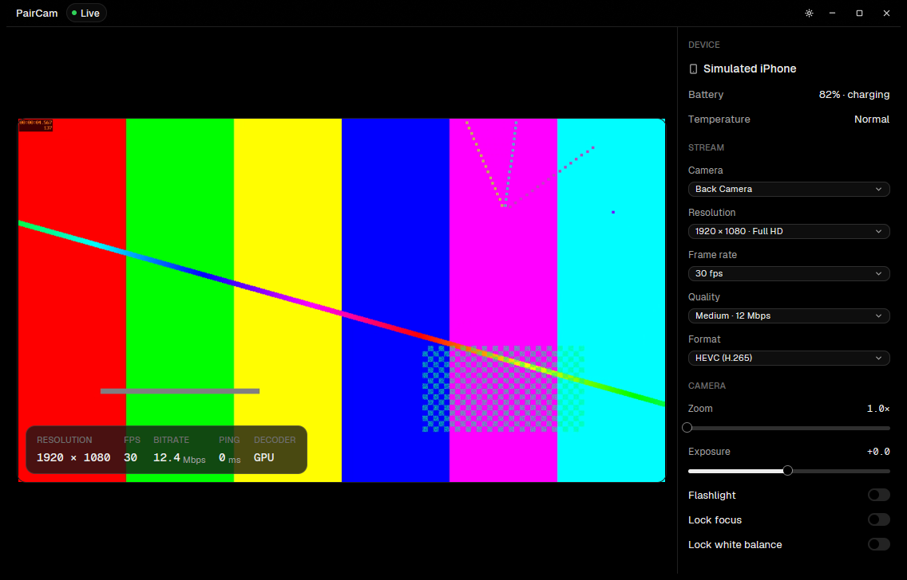

# PairCam

Use your iPhone as a high-quality webcam on your PC, over Wi-Fi. Free and open source.



> **Status: pre-alpha.** The desktop app works end to end against a phone simulator. The iPhone
> app and the Windows camera component are written but have not run on real devices yet. See
> [docs/ROADMAP.md](docs/ROADMAP.md).

## Why

Existing phone-as-webcam apps either lock HD, extra lenses and watermark-free video behind a
subscription, or they are unreliable. PairCam aims to be the one you would pick even if the others
were free: full camera quality, low delay, and a desktop app that feels like a real product.

## How it works

```
iPhone app ──(Wi-Fi)──▶ Desktop app ──▶ "PairCam" camera in Zoom, Teams, Meet, Discord, OBS
```

- The **phone** captures the camera and compresses it with its hardware encoder (HEVC or H.264).
- The **desktop app** finds the phone on the network, pairs with a 6-digit code, receives the
  encrypted stream, decodes it on the graphics card, and feeds a virtual camera that Windows 11
  shows to every app like a real webcam.
- The desktop app also controls the phone: camera, resolution, frame rate, quality, zoom,
  exposure, focus and flashlight.

| Part | Built with | Where |
| --- | --- | --- |
| iPhone app | React Native (Expo) for the interface; a native camera engine in Swift | `apps/mobile` |
| Desktop app (Windows 11) | Rust and GPUI, with GPUI Kit components under a custom theme | `apps/desktop`, `crates/ui` |
| Desktop engine | Rust; FFmpeg with hardware decoding | `crates/engine` |
| Protocol | Rust and Swift implementations tested against shared vectors | `crates/protocol`, `protocol/vectors` |
| Virtual camera | C++, Windows 11 Media Foundation virtual camera (no driver) | `native/vcam` |
| Design tokens | One JSON source generating both apps' themes | `design/tokens` |

Android is planned after the iPhone app is solid.

## Documentation

- [Development](docs/DEVELOPMENT.md): setup, running, the simulator, checks
- [Architecture](docs/ARCHITECTURE.md)
- [Design direction](docs/DESIGN.md)
- [Protocol](docs/PROTOCOL.md)
- [Roadmap](docs/ROADMAP.md)
- [Prior art](docs/PRIOR-ART.md)

## License

[MIT](LICENSE). Bundled third-party work keeps its own licence: the Geist typeface (SIL Open Font
License), FFmpeg (LGPL, linked dynamically), GPUI and GPUI Kit (Apache-2.0).
